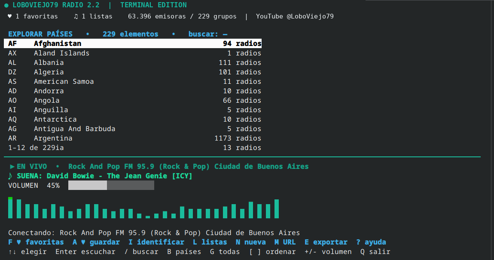

<div align="center">

# 📻 LoboViejo79 Radio

### 🎧 Terminal Edition v2.3 · Escuchá radios del mundo directamente desde Linux

**Una aplicación portátil de terminal, con emisoras por país, favoritas, listas personales, visualizador de audio, grabación de emisoras e identificación de canciones.**

[](https://kernel.org/)
[](https://www.python.org/)
[](#-instalación-y-ejecución)
[](#-catálogo-de-radios)
[](https://www.youtube.com/@LoboViejo79)

**📺 Canal:** [YouTube — LoboViejo79](https://www.youtube.com/@LoboViejo79)



*Captura aportada durante el desarrollo (versión anterior). En v2.3, la interfaz lleva la marca LoboViejo79 y muestra el indicador rojo `● REC` al grabar una emisora.*

</div>

---

## 📊 Catálogo de radios

| 🌍 Contenido | 📻 Cantidad |
|:--|--:|
| **Emisoras en el catálogo incluido** | **63.396** |
| **Grupos de país o código** | **229** |
| **Emisoras identificadas con código AR (Argentina)** | **1.173** |

> ℹ️ Estas cifras corresponden a la base de datos **incluida en esta versión**, no al número de radios activas comprobadas en tiempo real. Algunas URL pueden dejar de funcionar, cambiar o no transmitir metadatos. La consulta a Radio Browser requiere Internet.

## ✨ Funciones principales

- 🌎 **Explorar por países:** encontrá emisoras organizadas por país.
- 🔎 **Buscar radios:** filtrá por nombre o explorá el catálogo global.
- ❤️ **Mis favoritas:** guardá las emisoras que más escuchás y accedé a ellas con `F`.
- 📂 **Listas personalizadas:** creá colecciones, agregá/quita radios, renombrá listas y ordená sus elementos.
- 🔗 **Radios por URL:** agregá una emisora no incluida en el catálogo.
- 📤 **Exportación M3U8:** reproducí tus favoritas en otros programas o incorporalas a Jellyfin.
- 🎛️ **Control de reproducción:** iniciar, pausar, detener y ajustar volumen sin salir de la terminal.
- 🔴 **Grabar emisoras:** tecla `R`, indicador `● REC` rojo, cronómetro y guardado automático de audio en `.mka` con `ffmpeg` (sin recodificar).
- 📈 **Barras de sonido:** visualizador de audio basado en `cava`.
- 🎶 **Nombre del tema en reproducción:** lectura automática de metadatos ICY cuando la radio los proporciona.
- 🎤 **Identificación por audio opcional:** presioná `I` para intentar reconocer una canción usando SongRec o AudD.
- 💾 **Guardado permanente:** favoritas, listas e historial permanecen entre ejecuciones.
- 🧳 **Portátil:** no se instala la aplicación como paquete; se ejecuta mediante `radio.sh`.

## 🐧 Instalación y ejecución

**Distribuciones objetivo:** Fedora (incluida Fedora 45), Debian, Arch Linux y derivadas que dispongan de los paquetes indicados.

1. Descargá el código y descomprimí el ZIP, o cloná el repositorio cuando esté publicado.
2. Abrí una terminal en la carpeta del proyecto.
3. Ejecutá:

```bash
bash radio.sh
```

El lanzador comprueba `python3`, `mpv`, `cava` y `ffmpeg`. Si falta algo, **solicita autorización antes de instalar** dependencias del sistema mediante `dnf`, `apt-get` o `pacman`; no necesita `pip` ni Gum. Para impedir cualquier intento de instalación:

```bash
LOBOVIEJO79_NO_INSTALL=1 bash radio.sh
```

Si preferís instalar las dependencias vos mismo:

| Distribución | Comando |
|:--|:--|
| 🟦 Fedora | `sudo dnf install python3 mpv cava ffmpeg-free` |
| 🌀 Debian | `sudo apt update && sudo apt install python3 mpv cava ffmpeg` |
| 🏹 Arch / CachyOS | `sudo pacman -S --needed python mpv cava ffmpeg` |

> 🛠️ En Arch, el ejecutable `python3` viene con el paquete `python`; si el lanzador no lo encuentra, instalá ese paquete manualmente. Necesitás una terminal UTF-8 (preferentemente de al menos 100 × 30 caracteres) y una salida de audio configurada.

## ⌨️ Guía de comandos y teclas

### 🗺️ Navegación y búsqueda

| Tecla | Acción |
|:--:|:--|
| `↑` / `↓` | Mover la selección |
| `j` / `k` | Alternativa para navegar |
| `Re Pág` / `Av Pág` | Moverse diez posiciones |
| `Enter` | Entrar a un país/lista o reproducir la radio elegida |
| `B` | 🌍 Explorar países |
| `G` | 🌐 Ver todas las emisoras |
| `/` | 🔎 Buscar o filtrar en la vista actual |
| `U` | 🔄 Actualizar emisoras del país actual desde Radio Browser (sesión actual) |
| `R` | 🔴 Iniciar/detener **grabación** de la emisora que suena (indicador `● REC`) |
| `Esc` / `Retroceso` | Volver a la pantalla anterior |
| `?` / `H` | ❔ Mostrar ayuda en pantalla |
| `Q` | 🚪 Salir |

### ❤️ Favoritas y listas personales

| Tecla | Acción |
|:--:|:--|
| `F` | ❤️ Abrir **Mis favoritas** |
| `A` | ❤️ Agregar o quitar la radio seleccionada de favoritas |
| `L` | 📂 Ver las listas personalizadas |
| `N` | ➕ Crear una lista |
| `P` | 📌 Agregar la radio a una lista elegida |
| `T` | ✏️ Cambiar el nombre de la lista |
| `D` | 🗑️ Borrar una lista (con confirmación) |
| `X` | ➖ Quitar una radio de la lista actual (con confirmación) |
| `[` / `]` | ↕️ Subir o bajar una emisora dentro de una lista |
| `M` | 🔗 Añadir una emisora manualmente por URL |
| `E` | 📤 Exportar la lista a `.m3u8` |

### 🔊 Reproductor y música

| Tecla | Acción |
|:--:|:--|
| `Espacio` | ⏯️ Pausar o continuar |
| `+` / `-` | 🔉 Subir o bajar volumen |
| `S` | ⏹️ Detener reproducción |
| `I` | 🎶 Identificar la canción mediante análisis de audio, si está configurado |
| `R` | ⏺️ Iniciar o ⏹️ detener grabación; muestra `● REC` y duración |

## ❤️ Cómo crear tu lista de favoritas

1. Presioná `B` y elegí un país, o `G` para buscar globalmente.
2. Seleccioná una emisora y presioná `A` para guardarla.
3. Presioná `F` para ver **Mis favoritas**.
4. Usá `↑`/`↓` y `Enter` para escucharla.
5. Para organizarla, usá `[` y `]`, o `A` para quitarla.

Las favoritas se guardan automáticamente. Para organizar por temática, podés crear listas como **Rock**, **Noticias**, **Folklore** o **Deportes** con `N` y sumar emisoras con `P`.

## 🔴 Grabar una radio desde la terminal (v2.3)

La grabación es **manual**: nunca se inicia sola ni captura el micrófono. Usa `ffmpeg` para abrir **otra conexión al streaming** de la emisora que está sonando y guardar su audio original sin recomprimir. Podés seguir escuchando mientras grabás.

1. Seleccioná una emisora con `↑` / `↓` y presioná `Enter` para escucharla.
2. Presioná **`R`** para comenzar a grabar. El programa crea automáticamente la carpeta de grabaciones y muestra un indicador rojo **`● REC`**, el tiempo transcurrido `HH:MM:SS` y el archivo.
3. Presioná **`R`** de nuevo para terminar. `ffmpeg` cierra el archivo `.mka` y el programa muestra la ruta y el tamaño del archivo guardado.
4. También se detiene la grabación al pulsar **`S`**, cambiar de emisora o salir con **`Q`**. **Pausar la reproducción con Espacio no pausa la grabación**, porque se obtiene directamente de la transmisión.

**Ejemplo de la interfaz mientras está grabando:**

```text
◉ LOBOVIEJO79 RADIO 2.3  |  TERMINAL EDITION
▶ EN VIVO  •  Rock And Pop FM 95.9
♪ SUENA: David Bowie — The Jean Genie [ICY]
VOLUMEN 45%  ▓▓▓▓▓▓▓▓▓░░░░░░░░░░░
▂  ▆ ▂ ▆ █ ▄ ▂ ▆ █ ▄ ▃ ▂ █ ▆ ▂    (barras de sonido)
● REC  00:12:34  │ Rock_And_Pop_FM_95_9_2026-11-22_...
R detener grabación
```

**Ubicación predeterminada de los archivos:**

```text
~/Grabaciones/LoboViejo79-Radio/
└── Nombre_de_la_Emisora_2026-11-22_01-30-00_123456.mka
```

El formato **Matroska Audio (`.mka`)** suele funcionar con `mpv`, VLC y Jellyfin y puede contener MP3, AAC u otros códecs sin pérdida adicional de calidad por recodificación. Se eligió para no depender de un codificador específico. **No es lo mismo que MP3**: si necesitás `.mp3`, se puede convertir después según el códec disponible. Cada grabación es un archivo distinto, con fecha y hora en su nombre.

Si querés guardar las grabaciones en otro disco o directorio:

```bash
LOBOVIEJO79_RECORD_DIR="$HOME/Música/Grabaciones-Radio" bash radio.sh
```

📌 **Consideraciones:** `ffmpeg` necesita conectarse a Internet y que la URL admita el audio. Algunas emisoras bloquean conexiones adicionales o cambian sus streams; pueden fallar incluso si la reproducción funciona. El visualizador `cava` muestra el sonido del sistema, pero la **grabación toma solo el stream de radio**, no otros sonidos de la computadora. Grabá únicamente contenidos cuya conservación o reutilización esté permitida.

## 🎵 ¿Qué canción está sonando?

**Método 1 — Automático:** si la radio publica información ICY, el reproductor muestra lo que anuncia la transmisión (por ejemplo, *David Bowie — The Jean Genie*). No requiere configurar una cuenta, pero algunas emisoras no emiten estos metadatos o envían información incorrecta.

**Método 2 — Reconocimiento manual:** mientras escuchás una radio, presioná `I`. Se abre una conexión adicional al stream y se obtiene una muestra de aproximadamente 12 segundos con `ffmpeg` para intentar reconocer el tema. La reproducción actual continúa.

Para habilitar este método opcional, necesitás `ffmpeg` y **una** de estas alternativas:

- **SongRec** instalado y disponible como comando `songrec` (su disponibilidad varía por distribución).
- **AudD** con un token propio de [AudD](https://dashboard.audd.io/). Puede tener cuotas o costos, según el servicio.

Instalación de `ffmpeg`, si no lo tenés:

```bash
# Fedora
sudo dnf install ffmpeg-free

# Debian
sudo apt install ffmpeg

# Arch
sudo pacman -S --needed ffmpeg
```

Ejemplo para iniciar con AudD sin guardar el token en el código:

```bash
read -rsp 'Token AudD: ' LOBOVIEJO79_AUDD_TOKEN; echo
export LOBOVIEJO79_AUDD_TOKEN
bash radio.sh
unset LOBOVIEJO79_AUDD_TOKEN
```

🔒 **Privacidad:** el reconocimiento por audio no se ejecuta continuamente. Solo si pulsás `I` se envía una huella o fragmento de audio al servicio de reconocimiento elegido. No se utiliza el micrófono.

## 🧰 Comandos útiles desde la terminal

Los siguientes comandos pueden ejecutarse sin abrir la interfaz (varios solo requieren Python):

| Comando | Para qué sirve |
|:--|:--|
| `bash radio.sh` | ▶️ Abrir reproductor |
| `bash radio.sh --check` | 🩺 Comprobar dependencias `python3`, `mpv`, `cava` y `ffmpeg` (sin instalar) |
| `bash radio.sh --self-test` | 🔍 Comprobar catálogo local y biblioteca |
| `bash radio.sh --check-recognition` | 🎼 Verificar SongRec o AudD + `ffmpeg` |
| `LOBOVIEJO79_RECORD_DIR="$HOME/Grabaciones" bash radio.sh` | 🔴 Cambiar carpeta de grabación |
| `bash radio.sh --list-favorites` | ❤️ Listar favoritas guardadas |
| `bash radio.sh --export-favorites` | 📤 Exportar favoritas a M3U8 en el directorio de exportaciones |
| `bash radio.sh --export-favorites "$HOME/favoritas.m3u8"` | 📁 Exportar a una ruta elegida |
| `LOBOVIEJO79_NO_INSTALL=1 bash radio.sh` | 🛑 Ejecutar sin permitir instalación automática de dependencias |

**Nota:** `--check-recognition` puede devolver un código distinto de cero si el reconocimiento opcional no está configurado; la reproducción normal sigue estando disponible.

## 📂 Archivos del proyecto

```text
loboviejo79-radio-2.3/
├── 📄 README.md                   # Presentación e instrucciones
├── 📸 assets/
│   └── captura-terminal.png       # Captura para GitHub
├── 📻 radio.sh                     # Ejecutable de inicio
├── 🐍 radio.py                     # Interfaz TUI y reproducción
├── 🗂️ library.py                   # Favoritas y listas
├── 🎶 nowplaying.py               # Metadatos y reconocimiento
├── 🔴 recording.py                # Gestión y finalización de grabaciones
├── 🌎 catalog.csv.gz              # 63.396 emisoras incluidas
├── 🧪 tests/                     # Pruebas automatizadas
└── .gitignore
```

### 💾 Dónde se guardan los datos

La app utiliza `~/.local/state/loboviejo79-radio/` (o `$XDG_STATE_HOME/loboviejo79-radio/`):

- `biblioteca.json`: favoritas y listas personalizadas.
- `historial_canciones.jsonl`: historial de títulos detectados.
- `exportaciones/`: listas M3U8 exportadas.

Las **grabaciones** no van a la carpeta de estado; se almacenan por defecto en `~/Grabaciones/LoboViejo79-Radio/` o en `$LOBOVIEJO79_RECORD_DIR` si lo definís.

**Migración:** al iniciarse por primera vez, si encuentra datos de la versión anterior y el nuevo directorio todavía no existe, copia las favoritas, listas e historial sin borrar los originales. No sobrescribe una biblioteca ya existente. Para respaldar tus datos, copiá esa carpeta a otro disco.

### 📺 Usar favoritas en Jellyfin

```bash
bash radio.sh --export-favorites "$HOME/favoritas.m3u8"
```

Copiá el archivo al servidor donde está Jellyfin y configurá **TV en directo → Sintonizadores → M3U Tuner → Archivo o URL** con una ruta que Jellyfin pueda leer. Algunas radios solo emiten audio y su reproducción puede depender del cliente Jellyfin usado.

## 🧪 Pruebas y limitaciones

El proyecto incluye pruebas automáticas para carga de catálogo, gestión de listas/favoritas, migración de datos, metadatos, grabación y respuestas simuladas de reconocimiento. Para ejecutarlas:

```bash
python3 -m unittest discover -s tests -v
```

✅ Verificado: lectura del catálogo, **24 pruebas automatizadas**, grabación real de una señal MP3 servida por un servidor HTTP local y reproducción del archivo resultante verificada con `ffprobe`.  
⚠️ No se verificó la reproducción ni la grabación de cada radio remota; tampoco el reconocimiento real con SongRec/AudD. Para grabar una emisora concreta, hay que probar su URL y las condiciones de su servidor.  
📈 Las barras `cava` visualizan el monitor de audio PulseAudio/PipeWire del sistema, por lo que pueden reflejar otros sonidos además de la radio.

## 🚀 Publicar este proyecto en GitHub

1. Descomprimí `LoboViejo79_Radio_Terminal_v2.3_Grabacion_GitHub.zip`.
2. Creá un repositorio vacío en GitHub (por ejemplo, `loboviejo79-radio`).
3. En GitHub elegí **Add file → Upload files**.
4. Subí **los archivos y las carpetas que están dentro de `loboviejo79-radio-2.3/`**, incluido `assets/captura-terminal.png` y `catalog.csv.gz`.
5. Guardá los cambios. GitHub mostrará este README y su captura en la página principal.

**Importante:** subir el ZIP como un único archivo adjunto no publica el código de forma navegable; hay que extraerlo primero. No se incluye una licencia de uso explícita: elegí una (por ejemplo desde GitHub) si querés permitir la reutilización del proyecto por terceros.

## 🔗 Recursos y créditos

- 📻 [Radio Browser](https://www.radio-browser.info/) · [API](https://docs.radio-browser.info/)
- 🧰 [mpv](https://mpv.io/manual/stable/)
- 📈 [cava](https://github.com/karlstav/cava)
- 🔴 [FFmpeg: guardar transmisiones y copiar streams](https://ffmpeg.org/ffmpeg.html)
- 🎶 [SongRec](https://github.com/marin-m/SongRec) · [AudD](https://docs.audd.io/)
- 🎨 [Charm Gum](https://github.com/charmbracelet/gum) — inspiración de interfaz; **no es una dependencia**.

---

<div align="center">

**🐺 LoboViejo79 Radio — tecnología, Linux y música desde una terminal.**

📺 **[Visitar el canal de YouTube LoboViejo79](https://www.youtube.com/@LoboViejo79)**

</div>
